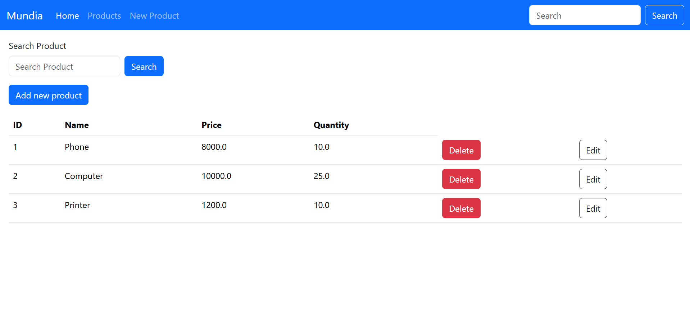
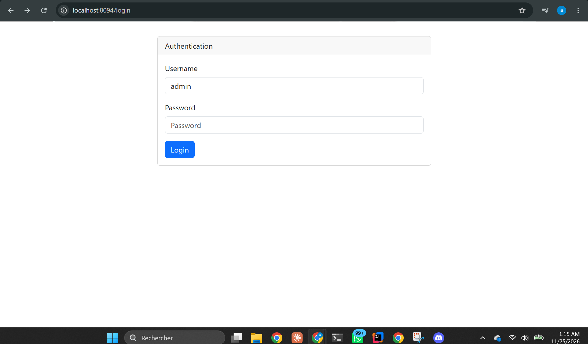
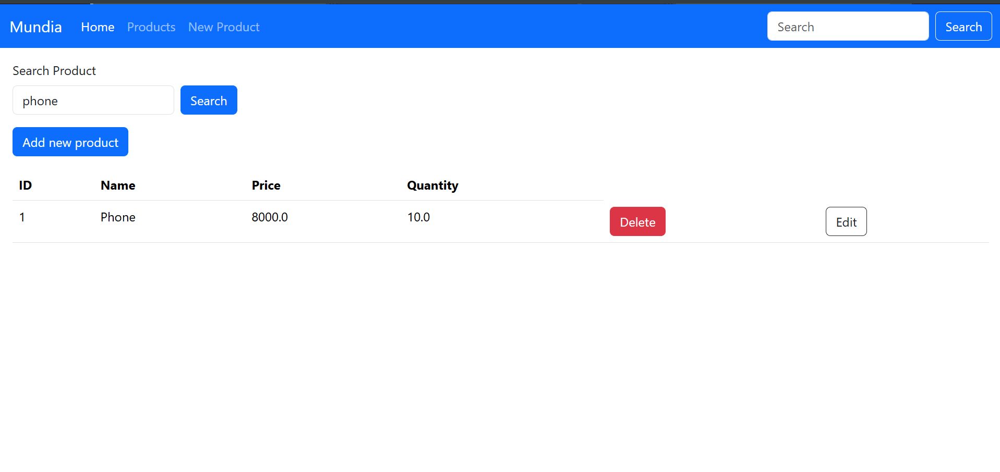
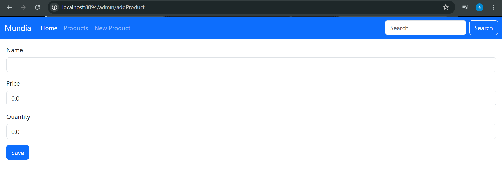
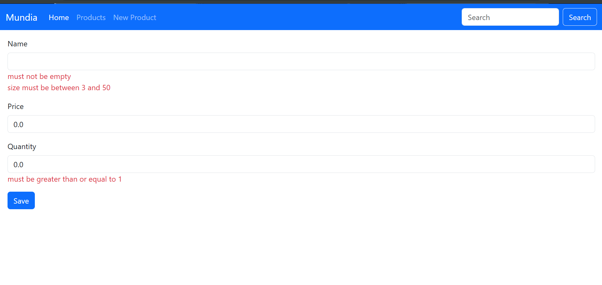
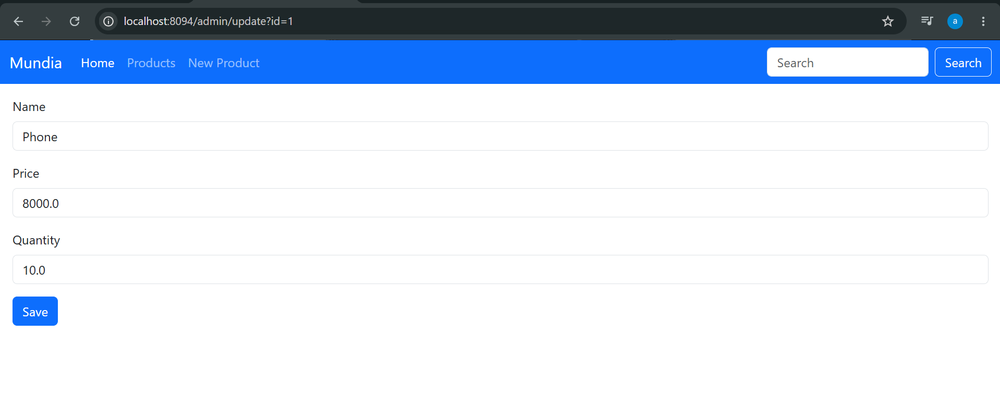
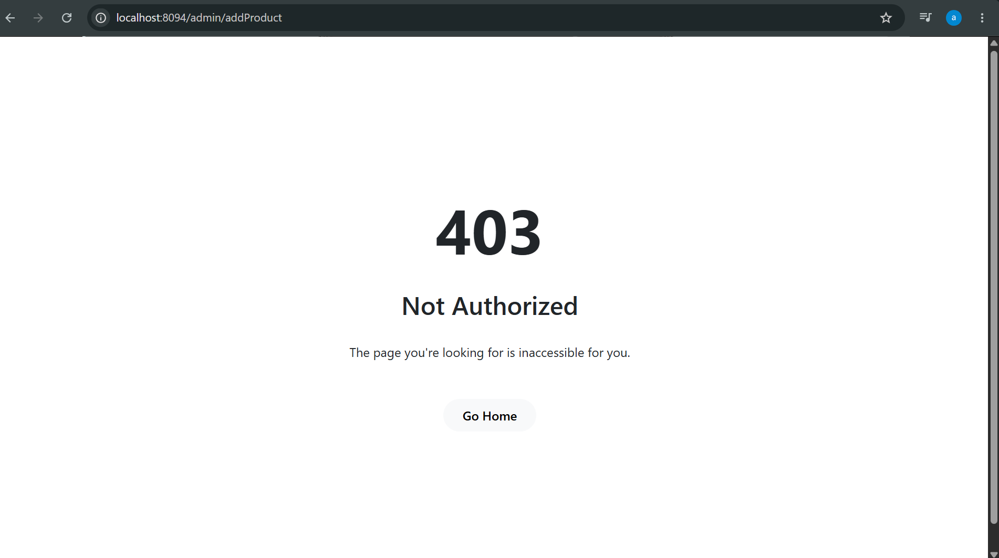

# Spring MVC Thymeleaf : Gestion de produits

Application web de gestion de produits développée avec **Spring Boot**, **Spring MVC**, **Thymeleaf** et **Spring Security**. Elle permet de consulter, rechercher, ajouter, modifier et supprimer des produits, avec une gestion des accès selon le rôle de l'utilisateur (`USER` ou `ADMIN`).



---

## Table des matières

1. [Fonctionnalités](#fonctionnalités)
2. [Aperçu](#aperçu)
3. [Technologies utilisées](#technologies-utilisées)
4. [Architecture du projet](#architecture-du-projet)
5. [Prérequis](#prérequis)
6. [Installation et lancement](#installation-et-lancement)
7. [Configuration (variables d'environnement)](#configuration-variables-denvironnement)
8. [Sécurité et rôles](#sécurité-et-rôles)
9. [Routes de l'application](#routes-de-lapplication)
10. [Validation des données](#validation-des-données)
11. [Améliorations possibles](#améliorations-possibles)
12. [Auteur](#auteur)

---

## Fonctionnalités

- Authentification avec une **page de login personnalisée**
- Gestion des rôles : `USER` et `ADMIN`
- Affichage de la liste des produits
- **Recherche** de produits par nom (insensible à la casse)
- **Ajout** d'un produit (réservé aux administrateurs)
- **Modification** d'un produit existant (réservé aux administrateurs)
- **Suppression** d'un produit (réservé aux administrateurs)
- **Validation** des formulaires avec affichage des messages d'erreur
- Page personnalisée **« Accès refusé »** (403)
- Interface responsive avec **Bootstrap**
- Layout commun avec **Thymeleaf Layout Dialect**

---

## Aperçu

### Page de connexion



### Liste des produits


### Recherche d'un produit



### Ajout d'un produit



### Validation du formulaire



### Modification d'un produit



### Accès refusé



---

## Technologies utilisées

| Technologie | Rôle |
|---|---|
| Java 21 | Langage |
| Spring Boot 4.1.2 | Framework principal |
| Spring MVC | Couche web (contrôleurs) |
| Spring Data JPA | Accès aux données |
| Spring Security | Authentification et autorisation |
| Thymeleaf + Thymeleaf Extras Spring Security | Moteur de templates |
| Thymeleaf Layout Dialect | Mise en page commune |
| Bootstrap 5.3 (WebJars) | Interface utilisateur |
| Jakarta Bean Validation | Validation des formulaires |
| Lombok | Réduction du code répétitif |
| H2 (par défaut) / MySQL | Base de données |
| Maven | Gestion des dépendances |

---

## Architecture du projet

```
src/
├── main/
│   ├── java/net/sahmi/mundiaspringmvc/
│   │   ├── MundiSpringMvcApplication.java
│   │   ├── entities/
│   │   │   └── Product.java
│   │   ├── repository/
│   │   │   └── ProductRepository.java
│   │   ├── sec/
│   │   │   └── SecurityConfig.java
│   │   └── web/
│   │       └── ProductController.java
│   └── resources/
│       ├── application.properties
│       └── templates/
│           ├── layout1.html
│           ├── login.html
│           ├── products.html
│           ├── new-product.html
│           └── notAuthorized.html
└── test/
docs/
└── images/        (captures d'écran du README)
```

---

## Prérequis

- **JDK 21** ou supérieur
- **Maven 3.8+** (ou le wrapper `mvnw` fourni)
- Une base de données (optionnel : H2 en mémoire est utilisée par défaut)
- Un IDE (IntelliJ IDEA recommandé)

---

## Installation et lancement

### 1. Cloner le dépôt

```bash
git clone https://github.com/adamsahmi1/-Spring-MVC-Thymeleaf.git
cd -Spring-MVC-Thymeleaf
```

### 2. Configurer les variables d'environnement (optionnel)

Voir la section [Configuration](#configuration-variables-denvironnement). Sans configuration, l'application démarre avec une base H2 en mémoire sur le port 8094.

### 3. Lancer l'application

Avec Maven :

```bash
./mvnw spring-boot:run
```

Sous Windows (PowerShell) :

```powershell
.\mvnw.cmd spring-boot:run
```

Ou depuis **IntelliJ IDEA** : ouvre la classe `MundiSpringMvcApplication` et clique sur **Run**.

### 4. Accéder à l'application

Ouvre [http://localhost:8094](http://localhost:8094) dans ton navigateur. Tu es redirigé vers la page de connexion.

---

## Configuration (variables d'environnement)

Les informations sensibles ne sont pas écrites en dur dans le code. Elles sont lues depuis des variables d'environnement, avec des valeurs par défaut (H2 en mémoire) si elles ne sont pas définies.

### `application.properties`

```properties
spring.application.name=mundia-spring-mvc
server.port=${DB_PORT:8094}
spring.datasource.url=${DB_URL:jdbc:h2:mem:products-db}
spring.datasource.username=${DB_USERNAME:sa}
spring.datasource.password=${DB_PASSWORD:}
spring.h2.console.enabled=true
spring.jpa.hibernate.ddl-auto=update
```

### Variables disponibles

| Variable | Description | Valeur par défaut |
|---|---|---|
| `DB_PORT` | Port du serveur web | `8094` |
| `DB_URL` | URL JDBC de la base de données | `jdbc:h2:mem:products-db` |
| `DB_USERNAME` | Utilisateur de la base | `sa` |
| `DB_PASSWORD` | Mot de passe de la base | *(vide)* |

### Dans IntelliJ IDEA

1. **Run > Edit Configurations...**
2. Sélectionne la configuration Spring Boot.
3. **Modify options** > coche **Environment variables**.
4. Ajoute par exemple :

```
DB_URL=jdbc:mysql://localhost:3306/mabase;DB_USERNAME=root;DB_PASSWORD=secret
```

### Dans le terminal

```bash
export DB_URL=jdbc:mysql://localhost:3306/mabase
export DB_USERNAME=root
export DB_PASSWORD=secret
./mvnw spring-boot:run
```

> Ne commite jamais de fichier `.env` ou de mots de passe. Ajoute `.env` à ton `.gitignore`.

---

## Sécurité et rôles

L'application utilise **Spring Security** avec une page de connexion personnalisée (`/login`).

| Rôle | Droits |
|---|---|
| `USER` | Consulter et rechercher les produits |
| `ADMIN` | Tout ce que fait `USER` + ajouter, modifier et supprimer des produits |

Un utilisateur sans les droits nécessaires est redirigé vers la page **« Accès refusé »** (`/notAuthorized`).

### Configuration de la chaîne de sécurité

```java
@Bean
public SecurityFilterChain securityFilterChain(HttpSecurity http) throws Exception {
    return http
            .formLogin(fl -> fl.loginPage("/login").permitAll())
            .authorizeHttpRequests(ar -> ar
                    .requestMatchers("/public/**", "/webjars/**", "/notAuthorized").permitAll()
                    .requestMatchers("/user/**").hasRole("USER")
                    .requestMatchers("/admin/**").hasRole("ADMIN")
                    .anyRequest().authenticated())
            .exceptionHandling(eh -> eh.accessDeniedPage("/notAuthorized"))
            .build();
}
```

### Comptes de démonstration

Les utilisateurs sont déclarés en mémoire, uniquement pour la démonstration.

| Utilisateur | Mot de passe | Rôles |
|---|---|---|
| `user1` | `1234` | USER |
| `user2` | `1234` | USER |
| `admin` | `1234` | ADMIN, USER |

---

## Routes de l'application

| Méthode | URL | Rôle requis | Description |
|---|---|---|---|
| GET | `/` | Connecté | Redirige vers `/user/index` |
| GET | `/login` | Public | Page de connexion |
| GET | `/user/index` | USER / ADMIN | Liste des produits |
| GET | `/user/searchProducts?productName=...` | USER / ADMIN | Recherche de produits par nom |
| GET | `/admin/addProduct` | ADMIN | Formulaire d'ajout |
| POST | `/admin/saveProduct` | ADMIN | Enregistre un produit (création ou modification) |
| POST | `/admin/update` (`id`) | ADMIN | Formulaire de modification |
| POST | `/admin/delete` (`id`) | ADMIN | Supprime un produit |
| GET | `/notAuthorized` | Public | Page d'accès refusé |

---

## Validation des données

L'entité `Product` utilise Jakarta Bean Validation :

```java
@Entity
@Getter @Setter @NoArgsConstructor @AllArgsConstructor @ToString @Builder
public class Product {
    @Id @GeneratedValue(strategy = GenerationType.IDENTITY)
    private Long id;
    @NotEmpty @Size(min = 3, max = 50)
    private String name;
    @Min(0)
    private double price;
    @Min(1)
    private double quantity;
}
```

Les erreurs sont affichées sous chaque champ du formulaire grâce à `th:errors`.

---

## Améliorations possibles

- [ ] Pagination de la liste des produits
- [ ] Messages de confirmation après sauvegarde ou suppression
- [ ] Gestion des catégories de produits
- [ ] Utilisateurs stockés en base de données (au lieu de la mémoire)
- [ ] Tests unitaires et d'intégration
- [ ] Déploiement avec Docker

---

## Auteur

**Adam Sahmi**, élève ingénieur en informatique, Université Mundiapolis

- GitHub : [@adamsahmi1](https://github.com/adamsahmi1)
